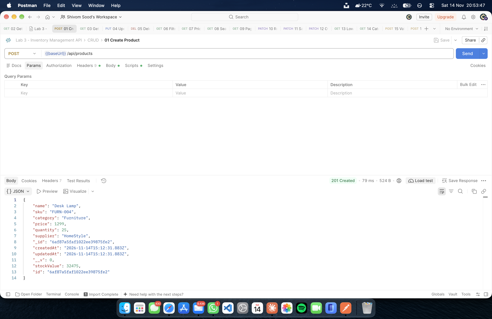
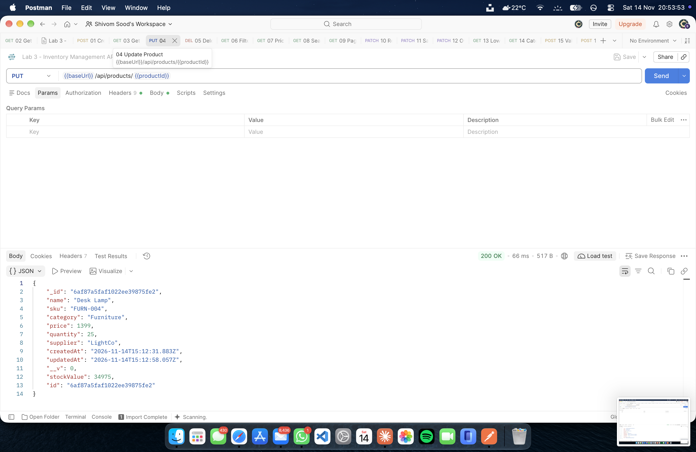
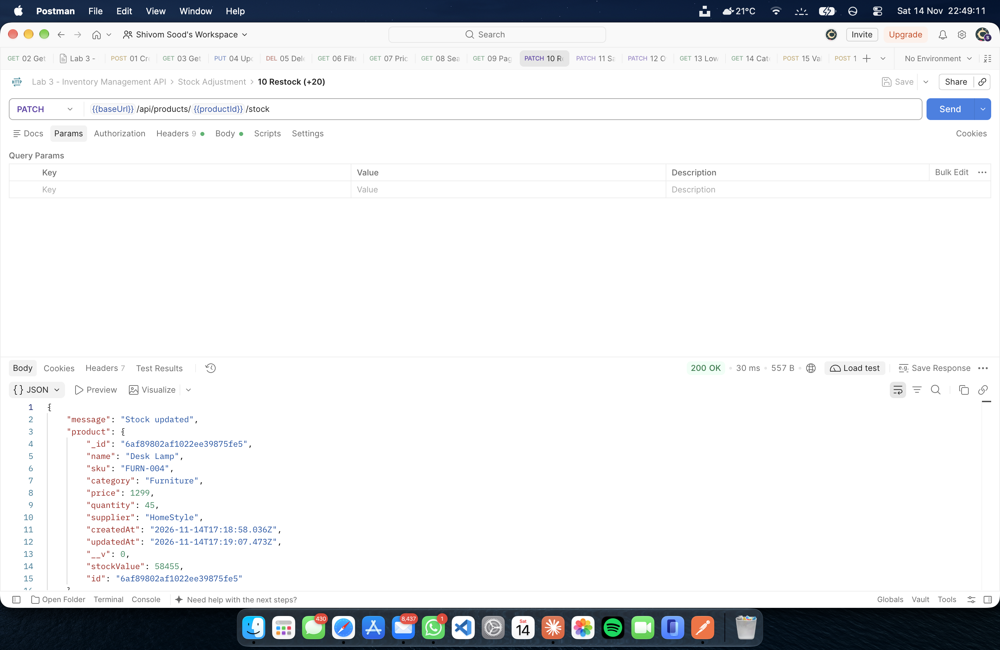
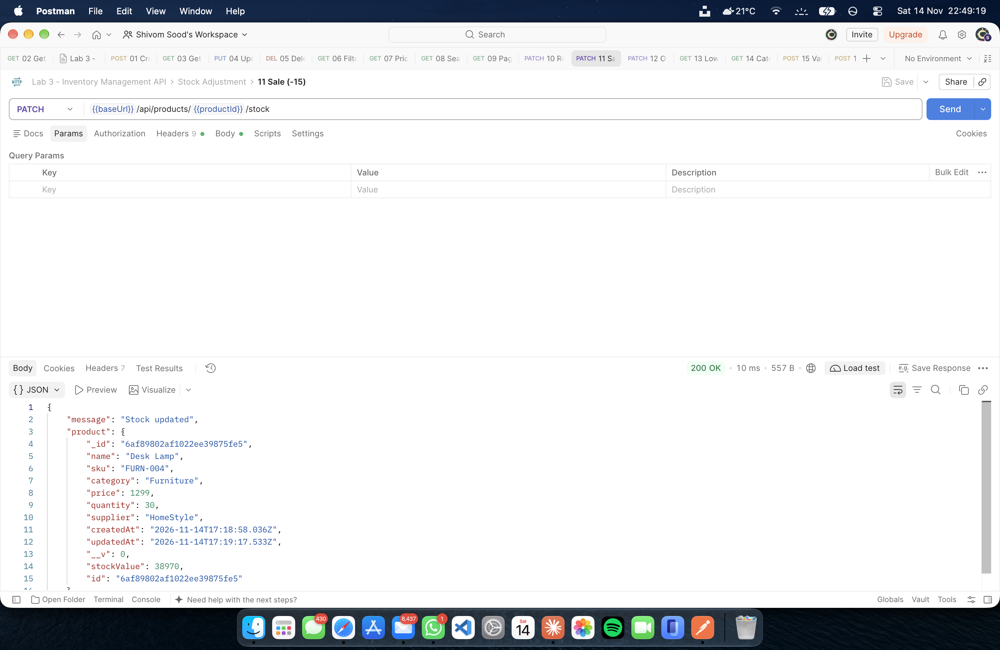
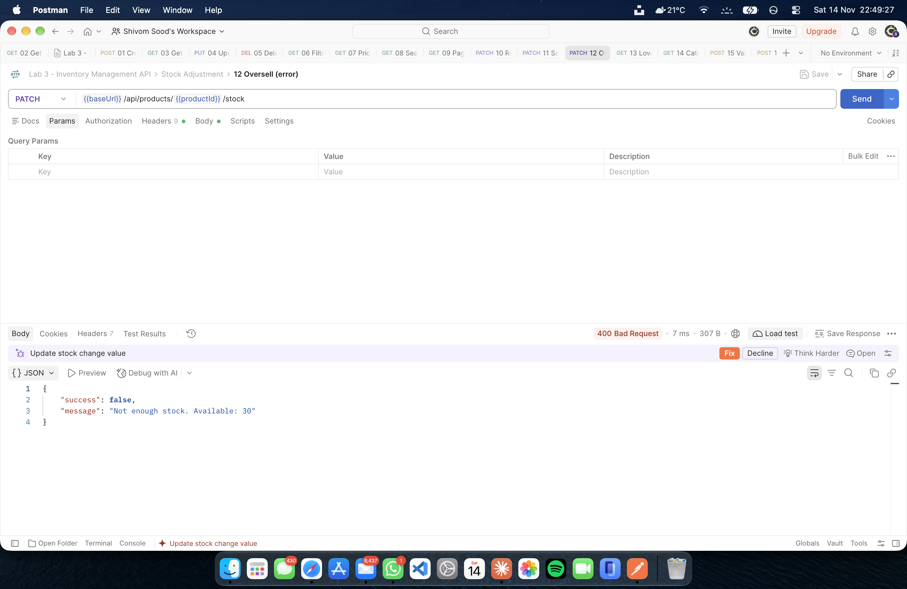
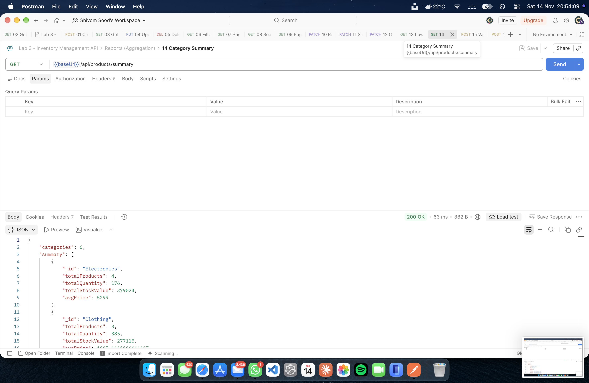
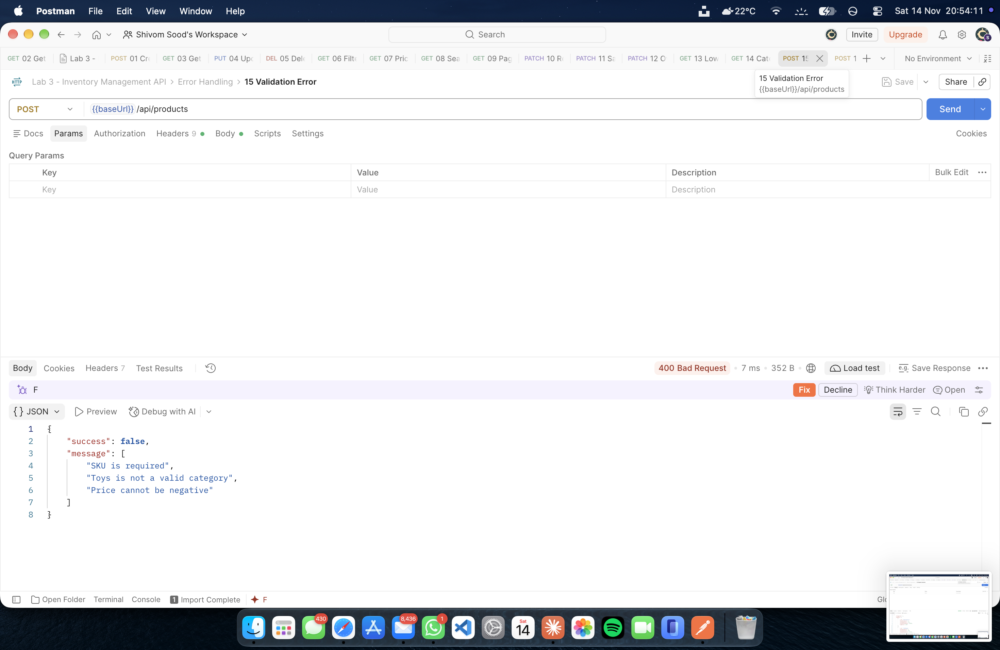
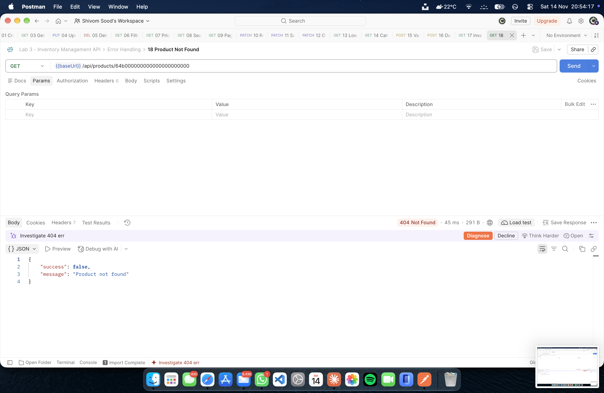

# Inventory and Data Management System

Lab Assignment 3 - Web Dev III (Node.js, Express, MongoDB, Mongoose)

REST API to manage products of a store. You can add, view, update and delete products, update stock (restock / sale), filter, sort and paginate products, and get reports using aggregation.

## Run
```
npm install
npm run seed     (adds sample products)
npm run dev
```
Create a `.env` file (see `.env.example`):
```
MONGO_URI=mongodb://127.0.0.1:27017/inventoryDB
PORT=5050
```
Server runs at http://localhost:5050

## Endpoints
| Method | Route | Description |
|---|---|---|
| POST | /api/products | Add a product |
| GET | /api/products | Get all products (filter, sort, pagination) |
| GET | /api/products/:id | Get one product |
| PUT | /api/products/:id | Update product |
| PATCH | /api/products/:id/stock | Restock or sale `{ "change": 20 }` / `{ "change": -5 }` |
| DELETE | /api/products/:id | Delete product |
| GET | /api/products/low-stock | Products with low quantity (`?threshold=10`) |
| GET | /api/products/summary | Category wise summary (aggregation) |

### Query params for GET /api/products
- `category` - e.g. `?category=Electronics`
- `search` - search by name, e.g. `?search=chair`
- `minPrice`, `maxPrice` - e.g. `?minPrice=500&maxPrice=3000`
- `sort` - e.g. `?sort=price` or `?sort=-price`
- `page`, `limit` - e.g. `?page=2&limit=5`

## Folder Structure
- config/db.js - database connection
- model/product.model.js - product schema with validation
- controller/product.controller.js - all the logic
- routes/product.routes.js - routes
- middleware/validate.middleware.js - id and stock validation
- middleware/error.middleware.js - 404 and error handler
- seed.js - sample data
- server.js - main file

## Postman Screenshots

### 1. Create Product
`POST /api/products`



### 2. Get All Products
`GET /api/products`


### 3. Get Product by ID
`GET /api/products/:id`


### 4. Update Product
`PUT /api/products/:id`



### 5. Delete Product
`DELETE /api/products/:id`


### 6. Filter by Category + Sort by Price
`GET /api/products?category=Electronics&sort=-price`


### 7. Price Range
`GET /api/products?minPrice=500&maxPrice=3000&sort=price`


### 8. Search
`GET /api/products?search=chair`


### 9. Pagination
`GET /api/products?page=2&limit=5`


### 10. Restock (+20)
`PATCH /api/products/:id/stock`



### 11. Sale (-15)
`PATCH /api/products/:id/stock`



### 12. Not Enough Stock (error)
`PATCH /api/products/:id/stock`



### 13. Low Stock Report
`GET /api/products/low-stock`


### 14. Category Summary (aggregation)
`GET /api/products/summary`



### 15. Validation Error
`POST /api/products`



### 16. Duplicate SKU
`POST /api/products`


### 17. Invalid ID
`GET /api/products/123`


### 18. Product Not Found
`GET /api/products/64b000000000000000000000`


